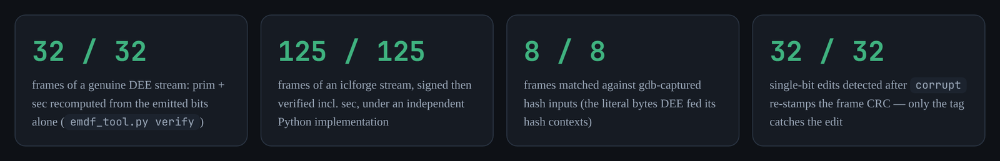
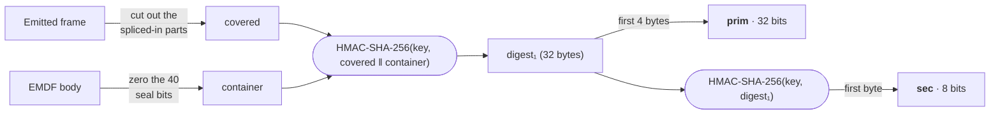
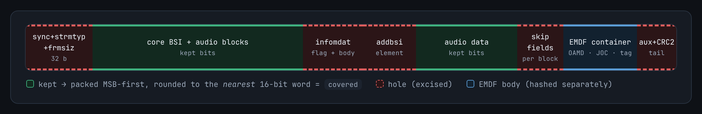

<div align="center">

# The EMDF protection field, decoded

**The 40 bits that mark a Dolby Atmos stream as genuine, and exactly how they are computed.**


-objects%20decoded-brightgreen)


[**Plain English**](#in-plain-english) ·
[**Try it**](#try-it-in-one-minute) ·
[**How it works**](#how-it-works) ·
[**Reading paths**](#pick-your-path) ·
[**Files**](#whats-in-here) ·
[**FAQ**](#faq)

</div>

---

> [!IMPORTANT]
> **Provenance.** The authenticated-region choice and the secondary-tag derivation are **not
> from any public document**. The specification explicitly declines to define them. They were
> established by examining a licensed reference encoder (DEE, including its binary) and
> validated bit-exactly against signed streams it emitted. This repository contains the key
> extracted from that encoder and artifacts derived from its output. It is published as
> **interoperability research**. You are responsible for complying with the terms of whatever
> you use it with.

## In plain English

Dolby Atmos on streaming services is delivered as DD+ audio: a sequence of short **frames**, about
32 milliseconds each. Every frame carries a tiny **5-byte seal**. Licensed Dolby decoders use that
seal as an authenticity gate for Atmos playback. The public specification says where the seal goes,
then refuses to say how it is made, so until now nobody outside Dolby could produce a valid one.

This repository shows how it is made:

* 🔐 **It is a real cryptographic signature**, a keyed HMAC-SHA-256, not a checksum.
* 🗝️ **The secret key is hidden inside Dolby's own encoder software.** It is included here.
* ✂️ **The tricky part is *what* gets signed:** not the frame as you receive it, but the frame as it
  looked *before* the Atmos metadata was spliced into it.

Every claim is proven bit for bit against real output from Dolby's encoder:



It also holds on real hardware. An Apple TV plays an open-source stream sealed this way as Atmos,
and the same stream with a single wrong seal bit plays nothing at all
([details](docs/technical-report.md#54-on-hardware-apple-tv)).

<details>
<summary><b>📖 Jargon decoder</b> (click to expand)</summary>

| Term | Meaning |
|---|---|
| **DD+ / E-AC-3** | Dolby Digital Plus, the audio codec used by streaming services |
| **JOC** | Joint Object Coding: the extra data that turns DD+ into Dolby Atmos |
| **EMDF** | The small metadata container inside each frame that carries the Atmos data |
| **`emdf_protection`** | The 40-bit seal inside EMDF: a 32-bit **prim** tag plus an 8-bit **sec** tag |
| **DEE** | Dolby Encoding Engine, Dolby's licensed reference encoder |
| **HMAC-SHA-256** | A standard way to sign data with a secret key. Without the key, you can't produce a valid tag |
| **`covered`** | The part of the frame that gets signed (see [the tricky part](#the-tricky-part-what-gets-signed)) |
| **iclforge** | An open-source, clean-room DD+ encoder that now implements this signature |

The [primer](docs/README.md#glossary) has the full glossary.
</details>

## Try it in one minute

**Option 1: run the self-test.** No build and no dependencies, just Python 3:

```sh
python3 emdf_protection.py
```

```text
frame 0: prim=afac597c sec=0x2a stored=afac597c/0x2a MATCH
...
frame 7: prim=7d27da10 sec=0x82 stored=7d27da10/0x82 MATCH
self-test: 8/8 frames match DEE's emitted protection
```

**Option 2: do it by hand.** Paste this into a Python shell from the repository root. It signs
frame 0 using the exact bytes DEE hashed, and prints the same seal DEE wrote into the stream:

```python
import base64, hashlib, hmac

key = base64.b64decode(open("keys/dee_emdf.key.b64").read())
covered = open("sample/protection/upd_02.bin", "rb").read()    # frame 0, pre-mux core
container = open("sample/protection/upd_03.bin", "rb").read()  # frame 0, EMDF body, tags zeroed

d1 = hmac.new(key, covered + container, hashlib.sha256).digest()
prim = d1[:4].hex()
sec = hmac.new(key, d1, hashlib.sha256).digest()[0]

print(f"prim={prim} sec={sec:#04x}")   # DEE wrote: prim=afac597c sec=0x2a
```

Want the full end-to-end check, from the raw stream alone? Follow
[**docs/reproduce.md**](docs/reproduce.md). Every experiment lists its expected output.

## How it works

Each frame is signed with two HMAC-SHA-256 calls using the same key:



```text
prim = HMAC-SHA-256(key, covered || container)[0:4]
sec  = HMAC-SHA-256(key, digest1)[0:1]          # digest1 = all 32 bytes, not the truncated prim
key  = 566cef6642595a1aa2ed20dcb1a62efb 4b38a65ce7b627390ced5a16e9fd679e
```

### The tricky part: what gets signed

When DEE builds an Atmos frame, it first encodes an ordinary DD+ frame, then splices the Atmos
metadata into the middle of it. The seal covers the frame as it was *before* that splice, so to
check a seal you have to undo it:



* 🟩 **Green, kept:** packed together in order, rounded to the nearest 16-bit word. This is `covered`.
* 🟥 **Red, holes:** cut out. These are the header and everything the muxer spliced in.
* 🟦 **Blue, EMDF body:** hashed separately as `container`, with its 40 seal bits set to zero.

Finding the hole boundaries means walking the E-AC-3 bitstream field by field, including channel
coupling. That walk is where implementations succeed or fail. The
[primer](docs/README.md#the-construction) lists every hole precisely.

## Pick your path

| You are… | Read | Time |
|---|---|:-:|
| 👀 **Curious** | You've read the essentials above. Next: the [primer](docs/README.md) | 5 min |
| 🎨 **A visual learner** | The [one-page visual](docs/emdf-protection.html) (download and open it in a browser) | 5 min |
| 🔬 **Skeptical** | The [technical report](docs/technical-report.md): binary addresses, verification, how it was found | 20 min |
| 🛠️ **Hands-on** | [`docs/reproduce.md`](docs/reproduce.md): run every experiment yourself | 30 min |
| 🧑‍💻 **Building an encoder** | [`emdf_protection.py`](emdf_protection.py) for the reference code, then [`scripts/`](scripts/) for a signer and verifier | |

> [!NOTE]
> GitHub shows `.html` files as source code. To see the visual, download
> [`docs/emdf-protection.html`](docs/emdf-protection.html) and open it locally, or enable GitHub
> Pages for this repository.

## What's in here

| Path | What it is |
|---|---|
| 📄 [`emdf_protection.py`](emdf_protection.py) | Reference implementation with a built-in self-test. **Start here.** |
| 📁 [`docs/`](docs/) | [Primer](docs/README.md) · [technical report](docs/technical-report.md) · [reproduction guide](docs/reproduce.md) · [one-page visual](docs/emdf-protection.html) |
| 📁 [`keys/`](keys/) | The extracted DEE key, base64 |
| 📁 [`scripts/`](scripts/) | Stream verifier and signer, Rust cross-check harness, iclforge patches |
| 📁 [`sample/`](sample/) | A stream DEE signed, plus the bytes it hashed for the first 8 frames |
| 📁 [`assets/`](assets/) | Images used in this README |

Every folder has its own short README explaining its files.

## Why it matters

Open-source DD+ Atmos encoding was blocked by two walls:

1. **Wall 1:** no open, Dolby-grade E-AC-3 core encoder.
2. **Wall 2:** this keyed seal. **Solved here.**

Since this research was done, [iclforge](https://github.com/iainchesworthlabs/iclforge) has shipped
a clean-room core encoder with channel coupling, closing Wall 1's software gap, and its signer
implements this exact construction. With the patches in
[`scripts/iclforge_patches/`](scripts/iclforge_patches/), `forge atmos out.ec3 4` produces a fully
signed stream with no key argument, byte-identical to this repository's Python signer. A full
open-source DD+ Atmos encode is now sealed automatically.

> [!NOTE]
> **Tested on hardware.** On an Apple TV 4K (tvOS 27.0), an iclforge stream signed this way
> decodes its Atmos objects, and the same stream with one seal bit flipped is muted entirely. In a
> blind listen, iclforge's and DEE's encodes of the same Helicopter render both played overhead.
> Apply `06-joc-clipgain.patch` as well: without it, tvOS plays iclforge's objects 24 dB too quiet.
> AVRs and TVs that decode DD+ themselves are still untested. See the
> [technical report](docs/technical-report.md#54-on-hardware-apple-tv).

## FAQ

<details>
<summary><b>Is this just a checksum?</b></summary>

No. A sweep of all 256 CRC-8 polynomials, CRC-32 and common 32-bit hash families over every
plausible region produced only isolated single-frame coincidences, which is what chance predicts
for an 8-bit field. Changing one seal bit while keeping the frame CRC valid is caught 32 out of 32
times. It is a keyed MAC.
</details>

<details>
<summary><b>Where does the key come from?</b></summary>

It is stored in DEE's `dee_audio_filter_ddp_atmos.so` as a 64-character hex string with every
byte XORed with `0x7a`. Function-level addresses are in the
[technical report](docs/technical-report.md#3-where-it-lives-in-the-binary).
Every DEE frame uses `key_id` 0.
</details>

<details>
<summary><b>Do I need Dolby software to reproduce this?</b></summary>

No. The self-test and the hand calculation above run on the files in [`sample/`](sample/). The
end-to-end verifier also needs an instrumented build of the open-source iclforge decoder to locate
audio-block bit positions. [`docs/reproduce.md`](docs/reproduce.md) shows how to build it.
</details>

<details>
<summary><b>Will my encoder's output play as Atmos on a real device?</b></summary>

On an Apple TV, yes: tvOS 27.0 decodes the objects of an iclforge stream signed this way and mutes
a stream whose seal is wrong. If you use iclforge, apply all six patches; the sixth fixes a level
bug that otherwise makes the objects 24 dB too quiet. AVRs and TVs that decode DD+ themselves are
untested. See the [technical report](docs/technical-report.md#54-on-hardware-apple-tv).
</details>

<details>
<summary><b>What about coupled frames?</b></summary>

They're handled. DEE's frames use coupling in all six blocks and verify 32 out of 32. iclforge's
own `verify-objects` still declines coupled frames, but that is a limit of its frame walker, not of
the construction. See the [open questions](docs/technical-report.md#6-open-questions).
</details>

## Related

* [**dolby-atmos-encoder**](https://github.com/raress96/dolby-atmos-encoder): the Rust crate whose
  hardware-fallback investigation motivated this research. See its README for licensing; portions
  ported from Cavern are non-commercial share-alike.
* [**iclforge**](https://github.com/iainchesworthlabs/iclforge): the clean-room E-AC-3 encoder whose
  signer implements this construction.
