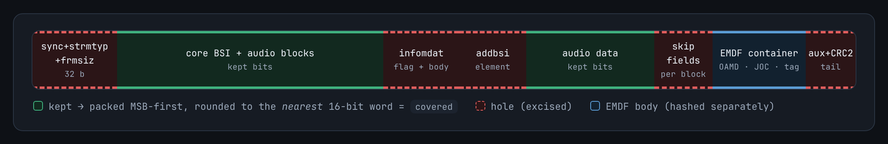

# Technical report: the EMDF protection field

[← Main README](../README.md) · [Primer](README.md) · [Reproduce the results](reproduce.md)

How the 40-bit `emdf_protection` field in DD+ Atmos streams is computed, where that computation
lives in the Dolby Encoding Engine (DEE), and how it was verified.

| Result | |
|---|:-:|
| Frames recomputed from DEE's captured hash inputs | **8 / 8** |
| DEE frames verified from the emitted bits alone (prim + sec) | **32 / 32** |
| Frames of an iclforge stream signed, then verified independently | **125 / 125** |
| Single-bit tag edits detected, with the frame CRC re-stamped | **32 / 32** |
| Python signer vs. patched iclforge signer on the same stream | **byte-identical** |
| Fresh DEE 5.2.1 encodes (7.1.4 channel-based, 768 kbit/s) verified from the emitted bits | **3133 / 3133** |
| Apple TV 4K, tvOS 27.0: signed iclforge stream / same stream with one tag bit flipped | **objects decoded / muted** |

**Contents:**
[1. The construction](#1-the-construction) ·
[2. Proof against captured inputs](#2-proof-against-captured-inputs) ·
[3. Where it lives in the binary](#3-where-it-lives-in-the-binary) ·
[4. Implementing it](#4-implementing-it) ·
[5. Independent verification](#5-independent-verification) ·
[5.4 On hardware](#54-on-hardware-apple-tv) ·
[6. Open questions](#6-open-questions) ·
[7. How it was found](#7-how-it-was-found)

## 1. The construction

ETSI TS 102 366 Annex H defines the `emdf_protection` field's layout, then calls its content
"implementation dependent". DEE fills it with two truncated HMAC-SHA-256 tags under one 32-byte
key:

```text
prim   (32 bits) = HMAC-SHA-256(key, covered || container)[0:4]
sec    (8 bits)  = HMAC-SHA-256(key, digest1)[0:1]      # digest1 = the full 32-byte primary digest
key_id (3 bits)  = 0 in every DEE frame
```

### The key

`dee_audio_filter_ddp_atmos.so` stores the key as a 64-character hex string. Each decoded byte is
XORed with `0x7a`:

```text
hex string in the binary:   2c16951c38232060d8975aa6cbdc54813142dc269dcc5d437697206c93871de4
HMAC key (after ^ 0x7a):    566cef6642595a1aa2ed20dcb1a62efb4b38a65ce7b627390ced5a16e9fd679e
```

A per-payload configuration table can supply a different key ([§3](#3-where-it-lives-in-the-binary)).
With none configured, DEE signs with this embedded default.

### The two messages

DEE feeds two independent HMAC contexts (`FUN_00381770`, objdump `0x281770`):

| Message | Content |
|---|---|
| `covered` | DEE's **pre-mux** core frame, from bit 32 (`fscod`) on, as it was *before* the Atmos muxer spliced in its metadata. It ends at the end of the audio data, on a 16-bit word boundary. |
| `container` | The EMDF body after its 16-bit sync and 16-bit length (`emdf_version` through `protection_bits_secondary`, byte-padded), with the 40 protection bits written as **zeros**. |

`key_id` sits at body bit 2 and is 0 in every frame, so whether DEE zeroes it while hashing cannot
be observed here.

DEE also supports an optional region table (`FUN_00380e70`) for hashing selected spans of a
buffer. Every frame in this encode hashed exactly one span (region count 0); the container is
simply absent from the covered buffer.

### Rebuilding `covered` from an emitted frame

A verifier only has the emitted frame, so it rebuilds `covered` by cutting out everything the
muxer added:



| Hole (cut out) | Extent |
|---|---|
| Header | bits 0–31: syncword, `strmtyp`, `substreamid`, `frmsiz` |
| `infomdat` element | the flag **and** its body |
| `addbsi` element | `addbsie`, `addbsil` and the bytes |
| `skipflde` | the single flag bit |
| Every block's skip field | `skiple`, plus `skipl` and `skipfld` when set |
| Tail | from the end of the audio data to the end of the frame: aux data and CRC2 |

What remains is packed MSB-first and rounded to the **nearest** 16-bit word: `(n + 8) // 16`
words, zero-padded up or truncated down.

> [!TIP]
> The hole boundaries can only be found by walking the E-AC-3 bitstream field by field, through
> the BSI and every audio block, including channel coupling. That walk is where implementations
> succeed or fail.

## 2. Proof against captured inputs

While DEE encoded a 1-second 5.1 test signal to [`sample/out.ec3`](../sample/out.ec3), gdb
breakpoints on its SHA-256 update routine (`FUN_003b5460`) captured every hash input. Recomputing
from those inputs in Python:

| Frame | prim (DEE) | prim (HMAC) | sec (DEE) | sec (HMAC) |
|------:|-----------:|------------:|----------:|-----------:|
| 0 | `afac597c` | `afac597c` ✔ | `0x2a` | `0x2a` ✔ |
| 1 | `4b97146f` | `4b97146f` ✔ | `0x3b` | `0x3b` ✔ |
| 2 | `1c2a7949` | `1c2a7949` ✔ | `0x13` | `0x13` ✔ |
| 3 | `a9f1d0ed` | `a9f1d0ed` ✔ | `0x46` | `0x46` ✔ |
| 4 | `a2d2f9b6` | `a2d2f9b6` ✔ | `0x8c` | `0x8c` ✔ |
| 5 | `bf4493d0` | `bf4493d0` ✔ | `0x9d` | `0x9d` ✔ |
| 6 | `d1f3559b` | `d1f3559b` ✔ | `0x90` | `0x90` ✔ |
| 7 | `7d27da10` | `7d27da10` ✔ | `0x82` | `0x82` ✔ |

The captured inputs are in [`sample/protection/`](../sample/protection/), and
[`emdf_protection.py`](../emdf_protection.py) repeats this check as its self-test.

**Structural confirmations:**

* The hashed container is byte-identical to the emitted EMDF body except for the 40 protection
  bits, which are zero while hashing (frames 0–7, checked bit for bit).
* `key_id` is 0 in all 8 frames; the emdf.rs parser and `bodies.json` agree.
* DEE's SHA-256 is **stock**: standard IV at file offset `0xb51c20`, standard round constants as
  immediates. Its context stores the chaining state as little-endian words, which does not affect
  the digest.
* The HMAC is textbook: ipad block at ctx+`0x80`, opad at ctx+`0xc0`, re-hash on finalize
  (`FUN_00386d00`).
* The CRC-16 routines (`FUN_004aca20`, `FUN_004acea0`) are the per-substream DD+ frame CRCs and
  have nothing to do with EMDF protection.

## 3. Where it lives in the binary

Addresses are objdump virtual addresses in `dee_audio_filter_ddp_atmos.so` from the DEE build
examined. Ghidra addresses are `+0x100000`. Other builds will differ.

| Role | Address | Notes |
|---|---|---|
| Key string builder, unhex + XOR `0x7a` | `0x286ee0` | builds the hex string on the stack byte by byte |
| Keyed hash init (HMAC) | `0x286200` | copies the key into ipad/opad, XOR `0x36`/`0x5c`, hashes ipad |
| SHA-256 IV | `0xb51c20` | standard constants |
| Hash update | `0x2b5460` | also called directly for region spans |
| Hash finalize (HMAC outer) | `0x286d00` | digest, reinit, hash opad ‖ digest |
| Protection compute | `0x281770` | per-payload-id config lookup: configured key if present, else the embedded default |
| Covered-span feeder | `0x280e70` | region-table driven |
| EMDF packer (container + tag writeback) | `0x27f900` | writes prim bytes at `0x27fba0..0x27fbc2`, sec at `0x27fbe0..0x27fc01` |
| DD+ frame CRC-16s (ruled out) | `0x4aca20` / `0x4acea0` | tables at `0xb99080` / `0xb99280` |

The config table (`FUN_00381770`, `param_4`) can override the key per payload id
(`plVar9[1] != NULL` → `FUN_00386200(ctx, key, len)`). With no key material configured, the
embedded default is used. That is what this build shipped and what it hashed with.

## 4. Implementing it

In an encoder:

1. Take the core frame **before** the Atmos splice (`infomdate=0`, `addbsie=0`, no skip fields),
   from byte 4 to the end of its audio blocks, on a 16-bit word boundary. This is `covered`.
2. Build the EMDF body (`emdf_version` through `protection_bits_secondary`) with `key_id = 0`
   and the 40 protection bits zeroed.
3. `prim = HMAC-SHA-256(key, covered || body)[0:4]`
4. `sec = HMAC-SHA-256(key, digest1)[0:1]`, where `digest1` is the full 32-byte primary digest.
5. Write `prim` and `sec` into the body. Then splice `infomdat`, `addbsi`, the skip fields and the
   EMDF into the frame, and finalize `frmsiz` and CRC2.

In a verifier, rebuild `covered` from the emitted frame by cutting out the holes
([§1](#rebuilding-covered-from-an-emitted-frame)), then compare both tags.
[`scripts/emdf_tool.py`](../scripts/emdf_tool.py) does exactly this.

## 5. Independent verification

### 5.1 From the stream alone

[`scripts/emdf_tool.py`](../scripts/emdf_tool.py) recomputes both tags from the emitted bitstream
and the key, with **no** captured hash inputs:

```sh
python3 scripts/emdf_tool.py verify  <in.ec3>              # recompute prim + sec and compare
python3 scripts/emdf_tool.py sign    <in.ec3> <out.ec3>
python3 scripts/emdf_tool.py corrupt <in.ec3> <out.ec3>    # flip one prim bit per frame, CRC kept valid
```

It parses everything itself except each audio block's skip point and the end of the audio data,
which need a coupling-capable block walker. Those come from an iclforge decoder built with
[`03-bitpos-trace.patch`](../scripts/iclforge_patches/).

| Check | Result |
|---|---|
| `verify sample/out.ec3` (DEE, 32 frames) | **32/32 valid, prim + sec** |
| Frames 0–2 vs. the captured table in §2 | identical (`afac597c/2a`, `4b97146f/3b`, `1c2a7949/13`) |
| `verify` after `corrupt` | **32/32 detected** (exit 1); only the EMDF tag can catch these edits |
| `sign` an unsigned 4-second iclforge stream, then `verify` | **125/125 valid, prim + sec** |

### 5.2 Inside iclforge

iclforge's signer (`libs/ac3/src/signing/emdf_atmos_signer.cpp`) already implemented this
construction: holes excised, packed MSB-first and rounded to the nearest 16-bit word, container
with both tags zeroed, `tag = HMAC(key, covered ‖ container)`. Its primary tags matched DEE's
construction on its own output (125/125), but it left the secondary tag at zero, and it had no key
to sign with. Patches in [`scripts/iclforge_patches/`](../scripts/iclforge_patches/) close the gap:

| Patch | Change |
|---|---|
| `01-infomdat-hole.patch` | `walk_frame` cuts out the **whole** `infomdat` element (flag + body), not just the flag bit, and no longer declines `infomdate=1` frames. Frames without the element hash exactly as before. |
| `02-secondary-tag.patch` | The signer writes `protection_bits_secondary` as `HMAC(key, digest1)[:1]`, and the verifier checks it. Previously it was left zero and ignored. |
| `04-default-signing.patch` | Ships the DEE key (`dee_default_signing_key()`) and signs every E-AC-3 Atmos encode with it by default. `05-signing-docs.patch` updates the docs to match and records the hardware result in §5.4. |
| `06-joc-clipgain.patch` | Writes the JOC clip gain as DEE does (`joc_clipgain_x_bits` 4). Not part of the seal, but without it tvOS plays iclforge's objects 24 dB too quiet (§5.4). |

With these applied:

* `forge atmos out.ec3 4` signs with the built-in key automatically, no key argument; its own
  `verify-objects` accepts it **125/125, including sec**.
* The same stream verifies 125/125 under the independent Python implementation.
* The default-signed file is **byte-identical** to one `emdf_tool.py sign` produces from the same
  unsigned stream.

> [!WARNING]
> Streams signed without `02-secondary-tag.patch` now fail verification on their secondary tag
> (124/125 mismatched in the test stream). Valid tags must carry both halves.

### 5.3 Inside dolby-atmos-encoder

The harness in [`scripts/emdf_rs_verify/`](../scripts/emdf_rs_verify/) drops test modules into a
copy of [dolby-atmos-encoder](https://github.com/raress96/dolby-atmos-encoder) (commit `faf3ef1`)
and checks the findings with that crate's own Rust parsers.

1. **The protection matches through the crate's own parser: 8/8.** With `eac3::parse_frames`,
   `find_dolby_emdf` and `emdf::field_offsets` on `sample/out.ec3`, every frame's stored
   `prim`/`sec` equals `HMAC(key, covered || body_zeroed)`. The zeroed body located by emdf.rs is
   byte-identical to DEE's captured second hash input. `key_id = 0`, and the protection lengths
   `(2, 1)` mean 32 + 8 bits, as the crate already assumes.
2. **The crate's stand-in `dolby_keyed_mac` does not match**, even with the real key. It hashes
   `key_id || body[..length selectors]`, whereas DEE hashes the pre-mux core frame first, then the
   *whole* zeroed body, and derives `sec` from `digest1` rather than from `body || prim`. The
   `EmdfProtector::primary(covered, nbits)` seam only receives the EMDF body, so it cannot express
   DEE's construction without also receiving the core frame.
3. **`covered` is the pre-mux core.** Parsed with the crate's `bsidump`, `covered` has
   `infomdate=0`, `addbsie=0` and skip fields off: exactly the input shape of the crate's own
   `inject_frame_skipfield`. Compared with the emitted frame, `covered`:
   * drops bits 0–31 (syncword, `strmtyp`, `substreamid`, `frmsiz`);
   * has `infomdate=0` with no `info_metadata` body. The emitted frame has `infomdate=1` with
     body `000 1 1 00 0 0`, i.e. `copyrightb=1`, `origbs=1`. emdf.rs writes 9 zero bits there, a
     small divergence from DEE;
   * has `addbsie=0` (emitted: `addbsil=1`, `addbsi=[01 10]`);
   * has an `audfrm` 3 bits shorter (8 vs. 11 bits before `spxattene`). See
     [§6](#6-open-questions);
   * lacks each block's `skiple` bit and, in the EMDF block, the `skiple` + `skipl(9)` + EMDF skip
     field;
   * ends at the end of the audio data, on a 16-bit word boundary, with no padding, aux data or
     CRC2.

In practice, the crate's pipeline already holds the right `covered`: the core frame it passes to
`inject_frame_skipfield`, from byte 4 to the end of its audio blocks. Signing just needs that
buffer passed into the protector. For `coregraft` (a DEE core with a replacement EMDF), swapping
the EMDF leaves `covered` unchanged, so DEE's `covered` plus the new zeroed body gives a valid tag.

### 5.4 On hardware: Apple TV

Played on an Apple TV 4K (2nd generation, tvOS 27.0) into a Samsung HW-Q990C over HDMI, the seal
decides whether anything plays at all. Each test compared three encodes of the same 7.1.4 WAV:

* **DEE:** DEE 5.2.1's `wav_encode_to_atmos_ddp` at 768 kbit/s.
* **iclforge:** `forge atmos-cbi` at 768 kbit/s with patches 01–05, signed by default.
* **Bad seal:** the iclforge file after `emdf_tool.py corrupt`, which flips one primary-tag bit per
  frame and re-stamps the CRC. It differs from the signed file by 3 bytes per frame.

A small tvOS app played each file with AVPlayer, and for levels it ran tvOS's own E-AC-3 JOC decoder
in process: `AVAudioConverter` from the stream's 12-channel `'ec+3'` format-list entry to 7.1.4.
macOS has no such decoder.

**Height check** (spoken labels and pink noise in L, R and the four tops, about −34.5 dB RMS each):

| Stream | Heard | L/R | Tops | Surrounds |
|---|---|:-:|:-:|:-:|
| DEE (dialnorm −27) | normal | −38.9 | −38.3 | silent |
| iclforge | very quiet | −58.9 | −61.3 | silent |
| iclforge, bad seal | **silent** | silent | silent | silent |
| iclforge with `06-joc-clipgain.patch` | not played | −34.8 | −37.1 | silent |

**Helicopter** (a heights-only 7.1.4 render of the Dolby demo, played blind): the iclforge encode
with patch 06 and DEE's encode both played overhead and decoded at the same level within 0.2 dB.
The bad-seal copy was silent.

What this shows:

* **tvOS checks the seal, and accepts this construction on a stream DEE never touched.** A signed
  iclforge stream decodes its objects into the right outputs; flipping one tag bit mutes the
  **whole** stream, in playback and in the in-process decode. tvOS does not fall back to the 5.1
  bed.
* **DEE's own fresh encodes verify too:** 1320/1320 frames of the height check and 1813/1813 of
  Helicopter, from the emitted bits alone.
* **iclforge's JOC clip gain was wrong for real decoders.** iclforge wrote `joc_clipgain_x_bits` 0,
  which its own decoder reads as unity; tvOS applies 2^(x−4), exactly 1/16 (−24 dB). DEE writes 4.
  [`06-joc-clipgain.patch`](../scripts/iclforge_patches/) makes iclforge write 4 too, and tvOS's
  object levels then match iclforge's own decode within 0.2 dB.
* iclforge's heights come out about 3 dB low in both decoders, so that shortfall is in its encoder,
  not in the seal or the decoder.

Only this device and OS were tested. AVRs and TVs that decode DD+ themselves are untested.

## 6. Open questions

| Question | Status |
|---|---|
| **Do certified decoders check the tag?** | tvOS does, and accepts this construction (§5.4): a signed iclforge stream decodes its objects, and one wrong tag bit mutes it. AVRs and TVs that decode DD+ themselves are untested. |
| **Do other encoders or configurations use the same key?** | Untested. The config table can supply a different key per payload id, so streams from other setups may use one. A commercial DD+ Atmos sample would answer it. |
| **Which 2 extra `audfrm` flags?** | The emitted frame has `skipflde=1` plus 2 extra zero flags compared with `covered`. Every candidate encodes to identical bytes for these frames, so it cannot be observed here. |
| **Can iclforge's `verify-objects` check DEE streams?** | Not yet. `walk_frame` declines coupled frames (`cplinu != 0`), and DEE's frames are coupled in all 6 blocks, so it reports DEE streams as unsigned. It needs the coupled-block syntax (`cplexpstr`, phase flags, coupling delta bit allocation, coupling mantissas) to find the end of the audio data. `emdf_tool.py` sidesteps this with the instrumented decoder. |

The end of `covered` could not be walked with emdf.rs, whose `skip_points`/`parse_audfrm` reject
DEE's coupled core. The nearest-16-bit-word rule is confirmed by `emdf_tool.py`'s 32/32 instead,
which takes the end of the audio data from iclforge's block walker.

## 7. How it was found

1. **Ruled out the CRCs.** The two CRC-16 routines are the per-substream frame CRCs, not EMDF
   protection. A sweep of all 256 CRC-8 polynomials (every init, xorout and reflection) and the
   standard CRC-32 space over 7 candidate regions found no match that held across frames, which
   pointed to a keyed MAC.
2. **Traced the live code path.** The EMDF container is prebuilt into a heap buffer that is
   reused across frames. The active packer is the second muxer copy (`FUN_003d6c70`): sync site
   `0x2d7e81`, writer `0x347480`.
3. **Located the writeback.** A log of the generic bit writer (`FUN_003de170`, 8854 calls) showed
   frame 1's prim `0x4b97146f` leaving as four consecutive 8-bit writes from caller `0x27fbbe`,
   inside the packer, right after a call to `FUN_00381770`. Unsigned frames write zeros through
   the same path.
4. **Decompiled `FUN_00381770`.** Two keyed-hash contexts are initialized from `FUN_00386ee0` /
   `FUN_00386200` and fed through `FUN_00380e70`, update and finalize: the classic HMAC shape,
   with a per-payload-id key lookup.
5. **Extracted the key.** `FUN_00386ee0` builds a 64-character hex string byte by byte on the stack
   and decodes it with XOR `0x7a` per byte.
6. **Identified the algorithm.** The SHA-256 IV is at `0xb51c20`. The hash context held the
   ipad/opad blocks live (`key⊕0x36…` at ctx+`0x80`, `key⊕0x5c…` at ctx+`0xc0`), and finalize
   re-hashes `opad || digest`: textbook HMAC-SHA-256. The first HMAC attempt failed only because
   the message arrives in *two* updates (covered buffer + container), not one.
7. **Validated.** Captured all hash inputs for frames 0–7 and matched every prim and sec in DEE's
   output byte for byte.
